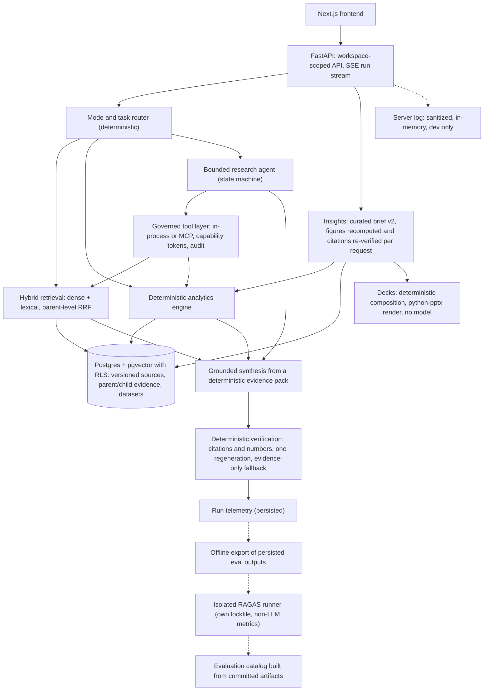

# MarketSignal

MarketSignal helps strategy teams turn fragmented customer, competitor, market and internal business evidence into defensible growth insights. It answers research questions with hybrid retrieval, deterministic analytics and a bounded research agent. Every claim cites an exact evidence passage or a computed result, and a deterministic verifier checks those citations before the answer is accepted. It is decision support: it shows the evidence for and against a hypothesis and states the gaps, and the strategist still makes the call.

The demo workspace is **Northstar Athletics**, a fictional athletic apparel company looking for Gen Z growth. All companies, competitors and data in this repository are synthetic.

## Problem

Strategy work draws on surveys, support logs, interview transcripts, competitor filings, market sizing spreadsheets and internal memos. The answers are spread across formats, the numbers disagree, and a summary that cannot be traced back to a source is not usable in a client discussion. Generic chat-over-documents tools make this worse: they paraphrase, invent figures and give no way to check a claim.

## Solution

- **Hybrid retrieval.** Dense vectors plus IDF-weighted Postgres full-text search, fused at the parent level with reciprocal rank fusion (RRF).
- **Deterministic analytics.** The model chooses *what* to compute; code computes it over versioned structured datasets. There is no SQL or code execution, and results are persisted and cited separately from evidence.
- **Grounded generation.** Answers are built from a deterministic evidence pack. Findings carry citations, inference is labelled as inference, and evidence gaps are stated.
- **Bounded research agent.** An explicit state machine with step, tool-call, token and time bounds, used when the router (or the user) decides a question needs it.
- **Governed MCP tools.** The agent has no database or filesystem access. It calls read-only tools through a governance pipeline with run-scoped capability tokens and an audit trail, in-process or over MCP Streamable HTTP.
- **Canonical evidence citations.** Every citation resolves to an immutable handle such as `NORTHSTAR/BRAND-STRATEGY@v1:P4.B2`, which points to an exact passage in an exact source version.
- **Evaluation.** Frozen datasets with dev/held-out splits, paired comparisons with confidence intervals, and negative results kept on the record.
- **Curated insights with claim types.** A versioned analyst brief (v2) feeds Insights and Growth Opportunities. Every statement is typed as Observed, Derived, Inference, Hypothesis or Forecast, a forecast must be stated by a cited source, and figures and citations are re-verified on every request.
- **Grounded presentations.** Selected findings become a `.pptx` deck composed deterministically on the server from the re-verified brief. No model writes slide text, and items that fail re-verification are excluded with a stated reason.
- **Telemetry.** Every run persists its route decision, stage timings, tool calls, token usage and verification attempts. Model reasoning is not recorded. A sanitized, in-memory server log shows the API's own requests in the developer tools.
- **RAGAS, offline.** An isolated runner scores persisted live outputs with RAGAS's non-LLM metrics, kept out of the backend's dependencies. Model-judged metrics are wired but have not been run.

## Product tour

The interface is chat-first. The left sidebar holds conversations (New chat, saved research first, then history grouped by recency) and collapses to a rail. The top bar has the workspace control (with the Evidence Library), the main navigation **Chat · Insights · Growth Opportunities · Analytics**, and two developer-tool icons, **Telemetry** and **RAG Evaluation**.

| Surface | Route (under `/w/NORTHSTAR`) | What it shows |
|---|---|---|
| **Chat** | `/ask`, saved conversations at `/ask/<id>` | Questions and answers. Research answers read as a short report with numbered citations, computed figures kept apart from evidence, research steps you can replay, and an evidence panel. Files can be attached; they go through the real upload API. |
| **Insights** | `/insights` | The curated brief in six categories: strategic opportunities, emerging signals, risks and blockers, competitor findings, optimization opportunities and future outlook. Each item shows its claim type, evidence for and against, and gaps. Findings can be selected for a presentation. |
| **Create presentation** | `/insights/deck?s=&o=&a=` | Pick insights, opportunities and analyses; see the outline; generate; preview the slides in the browser and download the `.pptx`. |
| **Growth Opportunities** | `/opportunities`, `/opportunities/O1` to `O4` | Opportunities with a qualitative status, supporting and contradicting evidence side by side, risks, gaps, a next step and the next question to investigate. There are no scores. |
| **Analytics** | `/analytics`, `/analytics/<id>` | Named business analyses grouped by business area, recomputed by the deterministic engine on each load, with base, filters, provenance and the insights that use them. |
| **Evidence Library** | `/evidence` | Every source and version, passage search, and an evidence panel with the exact cited passage in context. |
| **Telemetry** (developer tool) | `/dev/telemetry`, run trace at `/dev/telemetry/runs/<id>` | Tabs for Overview (charts of outcomes, latency, stages, model calls and tools), Runs, and Server logs (the sanitized API request log). The run trace shows routing, stage timings, tool calls, tokens, estimated cost and verification. |
| **RAG Evaluation** (developer tool) | `/dev/evaluation?tab=...` | Overview, Retrieval, Grounding & safety, Standard vs Research, RAGAS, Analytics, Failure analysis and Provenance. Every number links to its committed source artifact. |

## Architecture



Standard mode retrieves once and synthesises. Research mode lets the agent search, read and compute through governed tools before synthesis. Both paths end in the same verifier. Insights, opportunities and decks never call a model: they read the curated brief, recompute its figures and re-resolve its citations on each request. Dotted lines are developer and offline paths. More detail: [`docs/SYSTEM_DESIGN.md`](docs/SYSTEM_DESIGN.md).

## Engineering decisions

- **Hybrid retrieval with parent-level RRF.** Dense and lexical lanes are fused on the parent passage, not the child chunk, so two windows of the same passage reinforce each other. [ADR-0002](docs/adr/0002-hybrid-retrieval-parent-level-rrf.md)
- **Parent/child evidence model.** Small child chunks are embedded for recall; the parent (structural) unit is what gets cited. [ADR-0003](docs/adr/0003-parent-child-chunks-parent-citation-unit.md)
- **Immutable evidence handles.** Handles name the workspace, source, version and locator. The model cites run-local aliases that map deterministically to handles, and aliases are never stored as evidence identities. [ADR-0004](docs/adr/0004-evidence-handle-grammar-and-alias-citations.md), [ADR-0016](docs/adr/0016-source-versioning-and-purge.md)
- **Reranker tested, then rejected on held-out data.** A local cross-encoder improved MRR on dev but lowered recall@10 on the held-out split, so the production default is hybrid without it. It stays behind a flag for experiments. [ADR-0005](docs/adr/0005-local-cross-encoder-reranker.md), [Phase 2 addendum](docs/phase-reports/phase-2.md#addendum-review-decisions-2026-10-05-after-approval)
- **Structured, deterministic analytics.** Four governed analytics tools (`describe_dataset`, `aggregate`, `group_compare`, `filter_rows`) accept only closed enums and bounded values over versioned datasets, with half-even rounding; answers cite results as `[R#]` and the verifier checks every number exactly. [ADR-0020](docs/adr/0020-deterministic-structured-analytics.md)
- **Governed MCP tools with capability tokens.** The workspace comes from trusted run context, never from the model. Tools are read-only, scoped by a run-level token and audited. [ADR-0006](docs/adr/0006-governed-mcp-tool-boundary.md), [governed tools and MCP](docs/GOVERNED_TOOLS_AND_MCP.md)
- **Bounded agent state machine.** A custom loop with explicit states, every bound flagged and tested, and an append-only transcript, chosen over a framework so behaviour is inspectable. [ADR-0007](docs/adr/0007-bounded-agent-state-machine.md), [ADR-0015](docs/adr/0015-standard-vs-research-modes.md)
- **Postgres row-level security for workspace isolation.** The API runs as a non-privileged role, and every tenant table is guarded by RLS; a catalog test fails if one is not. [ADR-0009](docs/adr/0009-workspace-isolation.md)
- **Citation verification.** A deterministic verifier checks that every citation resolves, sits in the evidence pack and supports any number stated; it repairs, regenerates once, or falls back to an evidence-only answer. [Grounded answering](docs/GROUNDED_ANSWERING.md)
- **Claim-type contract.** Every curated statement carries a claim type, and the brief's schema rejects a claim without the support its type requires: Observed needs a supporting passage, Derived a computed figure, Inference and Hypothesis a passage or a figure, and Forecast a cited passage that itself states the projection. At request time every passage is re-resolved and marked verified, stale or withdrawn, and the UI shows each item's integrity.
- **RAGAS as an isolated runner.** RAGAS and its dependency tree live in `eval/ragas_runner` with their own lockfile and never enter the backend. The runner scores exported, persisted outputs, with RAGAS usage tracking switched off. [ADR-0021](docs/adr/0021-ragas-isolated-runner.md)
- **Grounded decks.** Decks are composed on the server from the same re-verified brief the pages use, with no new text beyond fixed section titles, and rendered with python-pptx to identical bytes for the same input. Items that fail grounding are excluded and reported. [ADR-0022](docs/adr/0022-grounded-deck-generation.md)
- **Developer server log.** A process-local, bounded ring buffer fed by a sanitizer that keeps only ids, enums, counts and durations: no questions, answers, passages, bodies, headers or query strings. It is mounted only outside production with developer endpoints on. [ADR-0023](docs/adr/0023-developer-server-log.md)
- **Telemetry and evaluation as product surfaces.** Run telemetry comes from persisted rows only; evaluation numbers come from a catalog built from committed artifacts, each with a pointer to its source file. [ADR-0013](docs/adr/0013-evaluation-methodology.md), [`eval/README.md`](eval/README.md)

## Measured results

Measured on fictional data with small, frozen evaluation sets, so confidence intervals are wide. Every number below comes from a phase report or the evaluation catalog ([`catalog.v1.json`](backend/src/marketsignal/devtools/eval_catalog_data/catalog.v1.json)), which points each value at its committed artifact.

**Retrieval** ([Phase 2 report](docs/phase-reports/phase-2.md); held-out test split, 17 retrieval-eligible items)

| Method | Recall@10 | MRR | Latency p50 |
|---|---|---|---|
| Dense (vector only) | 0.549 | 0.461 | 15 ms |
| Lexical (full text only) | 0.814 | 0.565 | 14 ms |
| **Hybrid (production default)** | **0.873** | 0.605 | 27 ms |
| Hybrid + cross-encoder reranker | 0.706 | 0.603 | 670 ms |

- Hybrid vs dense: ΔRecall@10 **+0.324** (95% CI +0.118 to +0.529); hit@10 improved on 6 items and regressed on 0 (p = 0.031). On dev the two were not distinguishable.
- **Negative result:** the reranker improved MRR on dev (+0.094, CI +0.006 to +0.192, n = 38) but lowered held-out Recall@10 by **0.167** (CI −0.343 to −0.020), so it was not adopted.
- **Not adopted:** the BGE query-instruction prefix (dense hit@10 −3 / +0 on dev, p = 0.25) and source balancing (hit@10 −1 and hit@20 −2 on dev).
- Caveat: the production default was chosen after seeing these test results, so the v0 test split is no longer a clean holdout for that choice.

**Grounded answers** ([Phase 3 report](docs/phase-reports/phase-3.md); live, 76 runs)

- 256/256 citations resolve to a stored passage and sit inside the run's evidence pack; 0 cross-workspace leaks.
- 9/9 insufficient-evidence questions abstained correctly; 1 over-refusal on 60 answerable items.
- End-to-end latency p50 4.8 s, p95 9.6 s.
- Verifier precision ([Phase 4 report](docs/phase-reports/phase-4.md#verifier-precision-former-phase-31)): the false-positive rejection rate on holdout fell from 0.130 to 0.058 (n = 69), but the false-negative acceptance rate stayed at 0.304 (n = 46). Non-numeric hallucinations such as entity names and causal claims can still pass.

**Standard vs research mode** ([Phase 4 report](docs/phase-reports/phase-4.md#standard-vs-research-research-v0-test-split-34-pairs-live); held-out test, 34 paired questions)

| | Standard | Research |
|---|---|---|
| Gold evidence retrieved | 0.794 | 0.906 (+0.111, CI +0.028 to +0.217) |
| Gold evidence cited | 0.822 | 0.937 (+0.115, CI +0.023 to +0.224) |
| Gold values stated | 0.736 | 0.747 (not distinguishable) |
| Tokens per run | 5,212 | 20,393 |
| Cost per run (eval harness) | $0.0134 | $0.0364 |
| End-to-end latency p50 / p95 | 5.78 s / 9.25 s | 14.40 s / 20.28 s |

Research mode finds and cites more of the expected evidence, but it costs more per run and is slower, and it does not state measurably more of the gold values. The router agreed with the reference mode on 62% of test questions.

**Structured analytics** ([Phase 5 report](docs/phase-reports/phase-5.md))

- Numeric faithfulness of answers: 201/201 on dev, 310/313 on holdout.
- Unsupported computed claims: 1/148 on holdout.
- **Routing generalised weakly:** task-type routing was 36/36 on dev but **31/54 on holdout**, so analytics questions phrased outside the cue list fall back to standard mode.
- The research-summary hand-off (A3) is implemented and tested offline but was **not measured live**.

**RAGAS, offline non-LLM metrics** ([`eval/baselines/ragas/`](eval/baselines/ragas/); RAGAS 0.4.3, computed on persisted live outputs, no model calls)

| Run | Context recall, evidence pack (IDs) | Context recall, cited (IDs) | Context precision, cited (IDs) | Context recall, pack (text similarity) |
|---|---|---|---|---|
| Grounded answers, Phase 3 live (n = 59) | 0.894 | 0.886 | 0.463 | 0.903 |
| Standard, Phase 4 held-out test (n = 30) | 0.736 | 0.724 | 0.478 | 0.753 |
| Research, Phase 4 held-out test (n = 30) | 0.864 | 0.843 | 0.495 (n = 29) | 0.881 |

- Excluded items: Phase 3, 11 expected abstentions and 6 items without gold handles; Phase 4, 4 expected abstentions per mode. Precision is undefined when an answer cites nothing, so one research item is not scored.
- **Reconciliation:** RAGAS ID recall counts every distinct gold handle, alternates included, so it reads lower than the historical "gold evidence retrieved" figure, which counts a fact as found when any accepted handle was retrieved (standard 0.736 vs 0.794, research 0.864 vs 0.906, n = 30). Recomputing the per-fact rule over the same items reproduces the historical figures exactly; the gap is definitional.
- **Not run:** the model-judged metrics (faithfulness, answer relevancy) are wired but were not run because no model credits were available. Reference-answer metrics need authored reference answers, which the gold sets do not hold.
- These are heuristics from the ragas library, not ground truth: ID scores depend on the gold handles being complete, and text-similarity scores are lexical.

## Local setup

The demo runs fully offline. `MS_LLM_ENABLED=false` refuses new runs before any provider call, and the UI shows **Live model unavailable**; saved conversations, evidence, analytics, telemetry and evaluation all work without a model.

**Prerequisites:** Docker (OrbStack, Colima or Docker Desktop), [uv](https://docs.astral.sh/uv/), Python 3.13 (uv installs it), Node 24 and pnpm.

```bash
make env          # create .env from .env.example (local placeholders only)
make up           # Postgres 18 + pgvector and Redis in containers
make sync         # backend dependencies
make migrate      # migrations, as the schema-owner role
make api-demo     # API on :8000, live model off, test workspaces hidden
```

If the local database already holds the Northstar workspace and its saved runs, skip to the frontend. On a **fresh database** only, load the corpus and the featured conversations:

```bash
make worker       # ingestion worker, separate terminal (needed only for ingestion)
make seed         # upload the synthetic corpus through the real upload API
make demo-seed    # import the featured saved conversations (idempotent)
make demo-verify  # optional: re-verify curated insight numbers and citations
make eval-catalog # optional: rebuild the evaluation catalog from committed artifacts
```

Then start the frontend and open <http://localhost:3000>. For a demo, a production build is recommended: it has no compile pauses and no development badge.

```bash
pnpm --dir frontend install
pnpm --dir frontend build && pnpm --dir frontend start   # recommended for a demo
pnpm --dir frontend dev                                   # development server
```

Files attached in Chat go through the real upload API, so they are processed only while `make worker` is running.

To score RAGAS offline (optional, no model calls), set up the isolated runner; its README has the scoring command:

```bash
uv --directory eval/ragas_runner sync --locked
```

`make demo` prints the same sequence. Live generation (`make api`) needs an Anthropic API key in `.env` and is off in the demo profile.

## Tests and quality

```bash
make check                                   # repository safety, ruff, mypy (strict), unit + integration tests
pnpm --dir frontend lint
pnpm --dir frontend typecheck
pnpm --dir frontend test
pnpm --dir frontend build
bash scripts/check_repo_safety.sh --all      # size, archive, private-content and absolute-path guard
env -u ANTHROPIC_API_KEY -u MS_ANTHROPIC_API_KEY uv --directory eval/ragas_runner run pytest -q   # RAGAS runner, keyless
```

Integration tests run as the non-privileged application role, so RLS is enforced in tests. CI ([`.github/workflows/ci.yml`](.github/workflows/ci.yml)) runs the safety check and a gitleaks secret scan, the backend suite, a retrieval-evaluation gate on a freshly seeded corpus, the RAGAS runner's lint, type check and tests (offline, with no secrets), and the frontend lint, typecheck, tests and build. To run the safety check before every commit: `git config core.hooksPath .githooks`.

## Demo

A 5 to 8 minute walkthrough, with exact URLs, talking points and a fallback plan: [`docs/DEMO_GUIDE.md`](docs/DEMO_GUIDE.md).

## Documentation

| Document | Purpose |
|---|---|
| [`docs/DEMO_GUIDE.md`](docs/DEMO_GUIDE.md) | Demo walkthrough and pre-demo checklist |
| [`docs/SYSTEM_DESIGN.md`](docs/SYSTEM_DESIGN.md) | The system as built: components, data model, request flow, isolation, purge, configuration |
| [`docs/ARCHITECTURE_PLAN.md`](docs/ARCHITECTURE_PLAN.md) | The approved architecture plan, with alternatives and tradeoffs |
| [`docs/adr/`](docs/adr/) | Architecture Decision Records and the spec-deviation register |
| [`docs/RETRIEVAL_DEEP_DIVE.md`](docs/RETRIEVAL_DEEP_DIVE.md) | Retrieval pipeline and the measurements behind each choice |
| [`docs/GROUNDED_ANSWERING.md`](docs/GROUNDED_ANSWERING.md) | Evidence pack, citations, verifier, computed results, abstention, SSE protocol |
| [`docs/RESEARCH_AGENT.md`](docs/RESEARCH_AGENT.md) | Mode router and the bounded research agent |
| [`docs/GOVERNED_TOOLS_AND_MCP.md`](docs/GOVERNED_TOOLS_AND_MCP.md) | Tool contract, capability tokens, audit, MCP transport, threat model |
| [`docs/INGESTION.md`](docs/INGESTION.md) | How a file becomes citable evidence |
| [`docs/PRODUCTIZATION_PLAN.md`](docs/PRODUCTIZATION_PLAN.md) | The product and UI decisions for the current interface |
| [`docs/PRODUCT_SPEC.md`](docs/PRODUCT_SPEC.md) | Original product and engineering specification |
| [`eval/README.md`](eval/README.md) | Evaluation methodology: datasets, splits, metrics, statistics |
| [`docs/phase-reports/`](docs/phase-reports/) | Per-phase reports with measurements and preserved failures |

## Limitations

- **Small, synthetic evaluation sets.** Held-out splits are small (17 retrieval-eligible test items, 34 paired research questions), so intervals are wide, and results on fictional data may not transfer to real engagements.
- **Routing.** The task-type router does not generalise well (31/54 on holdout), and the mode router misses simply phrased multi-step questions.
- **Verifier coverage.** Numbers and citations are checked exactly; non-numeric hallucinations (entity names, causal claims) can still pass.
- **Research depth.** Research mode gathers more evidence than synthesis states, and it costs more and is slower than standard mode.
- **Analytics scope.** No period-over-period operations, joins or custom formulas; units are inferred from column names; analytics runs only in research mode.
- **Curated insights.** Insights and Growth Opportunities come from a versioned brief authored by an analyst, not generated by the model. Its figures are recomputed and its citations re-verified on every request, but the selection and wording are human.
- **RAGAS coverage.** Only the non-LLM RAGAS metrics have been computed. Model-judged metrics were not run, and reference-answer metrics need reference answers that do not exist yet.
- **Attachments.** Files attached in Chat join the workspace evidence; they do not scope a single answer to that file.
- **Server log.** The log is per API process and held in memory: it starts empty after a restart, keeps only recent entries and does not include the ingestion worker.
- **Developer tools.** Telemetry and RAG Evaluation have no role checks yet; they are gated only by environment settings.
- **Not built.** Authentication, deployment, rate limits, a spend ledger and an answer cache are deferred. Do not upload real confidential data to a deployment that sends text to a third-party model provider without an approved data-handling policy.
